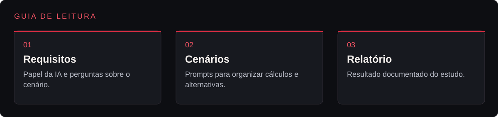
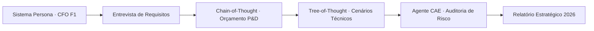

<p align="center">
  
</p>

<p align="center">Estudo de engenharia de prompts para simular orçamento, cenários e análise de riscos de uma equipe de F1.</p>

<p align="center"></p>

<p align="center"><a href="#visão-geral">Visão geral</a> &nbsp;·&nbsp; <a href="#prompts">Prompts</a> &nbsp;·&nbsp; <a href="#como-explorar">Como explorar</a></p>

---

<a id="explore-o-projeto"></a>




<table width="100%">
<tr><th align="left">Área</th><th align="left">O que você encontra</th><th align="left">Acesso direto</th></tr>
<tr><td><strong>Requisitos</strong></td><td>Papel da IA e perguntas sobre o cenário.</td><td><a href="docs/prompts/sistema_persona.md">Abrir requisitos →</a></td></tr>
<tr><td><strong>Cenários</strong></td><td>Prompts para organizar cálculos e alternativas.</td><td><a href="docs/prompts/cot_raciocinio.md">Abrir cenários →</a></td></tr>
<tr><td><strong>Relatório</strong></td><td>Resultado documentado do estudo.</td><td><a href="docs/relatorio_estrategico_2026.md">Abrir relatório →</a></td></tr>
</table>

<a id="visão-geral"></a>


O estudo organiza prompts para levantar requisitos, comparar alternativas de investimento e revisar riscos em uma simulação financeira de Fórmula 1. Os valores usados nos exercícios são premissas do cenário documentado.

<a id="principais-metodologias-aplicadas"></a>


| Metodologia | Como funciona no projeto |
|---|---|
| **Persona & Interview Pattern** | Configura a IA como CFO e Team Principal de F1, instruindo-a a entrevistar o usuário sobre pilotos, túnel de vento, CFD e motor antes de orçar. |
| **Chain-of-Thought (CoT)** | Exige raciocínio passo a passo na decomposição de custos de P&D, clusters de GPU e folha técnica dentro do limite de US\$ 145M. |
| **Tree-of-Thought (ToT)** | Explora três ramos estratégicos diante de problemas de arrasto aerodinâmico (chassi, software CFD ou túnel de vento) e seleciona o maior ROI. |
| **Critical Analysis Expert (CAE)** | Instancia um agente auditor ("advogado do diabo") que identifica riscos ocultos de inflação logística e cria reserva de contingência de US\$ 4M. |

<a id="prompts"></a>


| Arquivo | Tags | Aplicação |
|---|---|---|
| [sistema_persona.md](docs/prompts/sistema_persona.md) | `Persona` `Entrevista` | Definição do papel e coleta de requisitos. |
| [cot_raciocinio.md](docs/prompts/cot_raciocinio.md) | `CoT` `ToT` `Cenários` | Organização dos cálculos e comparação de alternativas. |
| [critica_cae.md](docs/prompts/critica_cae.md) | `CAE` `Riscos` `Revisão` | Análise crítica das propostas e contingências. |

<details>
<summary>Arquitetura do fluxo decisório</summary>



</details>

<a id="certificações"></a>


<p align="center">
  
  
</p>

<details>
<summary>Estrutura do repositório</summary>

```text
f1-strategic-financial-controller/
├── assets/
│   └── banner-v2.png               Banner do projeto
├── docs/
│   ├── prompts/
│   │   ├── sistema_persona.md                      Configuração da Persona CFO e Interview Pattern
│   │   ├── cot_raciocinio.md                       Prompts de Chain-of-Thought e cálculos
│   │   └── critica_cae.md                          Auditoria pelo Critical Analysis Expert
│   ├── relatorio_estrategico_2026.md               Plano financeiro consolidado e KPIs
│   ├── Prompt-Engineering-For-Everyone.jpeg        Certificado IBM
│   └── The-Art-Of-Prompt-Engineering.jpeg          Certificado IBM
└── README.md
```

</details>

<a id="como-explorar"></a>


1. Leia os prompts modulares na pasta [docs/prompts/](docs/prompts) na ordem: sistema_persona.md → cot_raciocinio.md → critica_cae.md.
2. Consulte o documento final consolidado em [docs/relatorio_estrategico_2026.md](docs/relatorio_estrategico_2026.md) para ver o cronograma, a distribuição do teto orçamentário e os indicadores de performance (KPIs).

---

<p align="center">
  <a href="https://github.com/arthurlynow098">GitHub</a> &nbsp;·&nbsp;
  <a href="https://arthurentsev.vercel.app/">Portfólio</a> &nbsp;·&nbsp;
  <a href="https://www.linkedin.com/in/entsevarthur/">LinkedIn</a>
</p>
